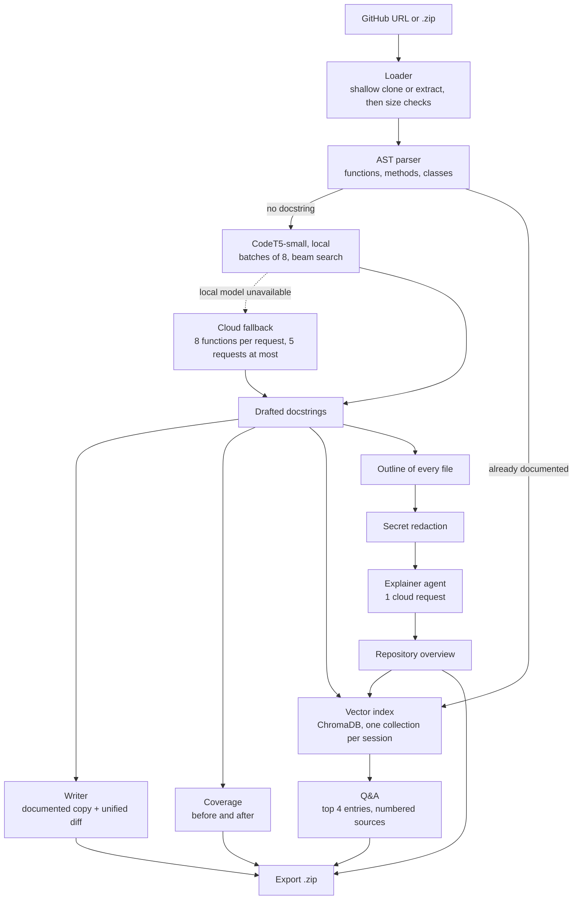
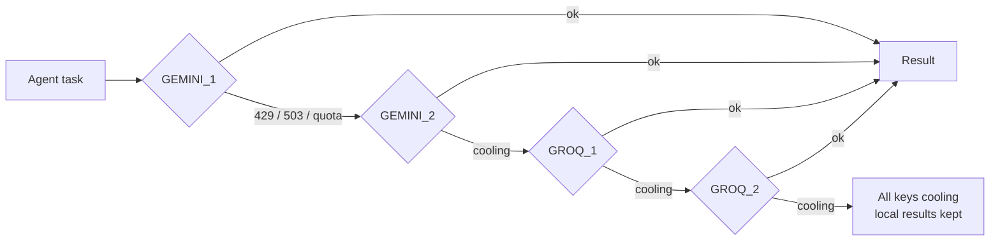

<h1 align="center">CodeDocAI</h1>

<p align="center">
  <strong>Docstrings for the functions nobody got around to documenting.</strong>
</p>

<p align="center">
  
  
  
  
  
  
  
</p>

Paste a public GitHub URL or upload a `.zip` of a Python project. CodeDocAI's own fine-tuned CodeT5 model, running inside the app with no API call, drafts every missing docstring and writes it back into a copy of your files. After that you can ask questions about the code in plain English, and every answer names the file and function it came from.

```diff
  def file_to_set(file_name):
+     """Convert a file to a set."""
      results = set()
      with open(file_name, 'rt') as f:
          for line in f:
              results.add(line.replace('\n', ''))
      return results
```

That diff is real output, for a helper in [buckyroberts/Spider](https://github.com/buckyroberts/Spider), and it is the whole idea. You get it as a patch you can `git apply`, alongside a coverage report that says how much of the project had docstrings before the scan and how much has them now.

## Contents

- [Why it is built this way](#why-it-is-built-this-way)
- [How a scan runs](#how-a-scan-runs)
- [The five screens](#the-five-screens)
- [What you download](#what-you-download)
- [The docstring model](#the-docstring-model)
- [Answers you can check](#answers-you-can-check)
- [What reaches the cloud model](#what-reaches-the-cloud-model)
- [When the cloud says no](#when-the-cloud-says-no)
- [Enterprise demo](#enterprise-demo)
- [Quick start](#quick-start)
- [Configuration](#configuration)
- [Project layout](#project-layout)
- [Known limits](#known-limits)
- [License](#license)

## Why it is built this way

Sending every function of a repository to a cloud model sounds simple until you try it on free-tier keys: a project with a hundred functions hits HTTP 429 within minutes, and the run dies halfway with nothing saved.

So CodeDocAI splits the work by how often it happens and how hard it is.

| Job | How often | Who does it | Cloud requests |
|---|---|---|---|
| Draft a docstring for one function | Hundreds of times per repo | Fine-tuned CodeT5-small on your CPU or GPU | 0 |
| Write the docstrings into your files, build the patch, count coverage | Once per file | Plain Python (`ast`, `difflib`) | 0 |
| Explain how the whole repository fits together | Once per scan | A CrewAI agent on Gemini, with Groq as backup | 1 |
| Answer a question about the code | Once per new question | A CrewAI agent, fed the four closest pieces of code | 1 |

A normal scan therefore costs one cloud request, however large the repository is. Everything in the first two rows is finished and saved before that request goes out, which means a rate limit can cost you the overview but never the docstrings.

## How a scan runs



The pipeline in [`backend/pipeline.py`](backend/pipeline.py) knows nothing about the interface. It is a generator that yields events (`progress`, `result`, `partial`, `done`, `rate_limited`, `error`), and the Streamlit screens just render whatever arrives.

## The five screens

**Scan.** Give it a root GitHub URL such as `https://github.com/owner/repository`, or a `.zip` up to 100 MB. The loader clones with `depth=1`, checks the limits (100 MB, 500 Python files), and walks each file with Python's `ast` module. You get a ledger: one row per file, with how many functions it has and how many are missing a docstring, plus a rough time estimate for the next step.

**Generate.** A live feed shows each step as it happens: parsing, drafting in batches, indexing, then the overview. The scanned copy of your code is deleted the moment this finishes. If the cloud doesn't answer, the screen keeps everything produced locally and offers two buttons, one to read the docs without an overview and one to retry only the overview.

**Docs.** The overview sits on top, then coverage (before, after, docstrings drafted, a per-file table), then every function and class in an expandable row. Rows carry a badge when it matters: `AI DRAFT` for model-written text, `NO DOCSTRING` for classes left alone, `NOT GENERATED` when neither model produced anything. A search box and a filter (`Everything`, `AI drafts`, `No docstring`, `Already documented`) cut a long list down.

**Q&A.** Ask anything about the scanned code. Two starter questions are generated from your repository, not from a canned list: one about the project, one about its largest file. Answers render as Markdown with citation pills like `spider.py::Spider.crawl_page()`.

**Export.** One button builds the archive in memory and downloads it.

Navigation is a rail across the top, the browser's back and forward buttons work, each screen has its own tab title, and a page refresh brings your scan back because the session id travels in the URL.

## What you download

```
codedocai_export.zip
├── documentation.md       the overview and every docstring, grouped by file
├── coverage_report.md     documentation coverage before and after, per file
├── docstrings.patch       the drafted docstrings as a unified diff
├── documented_source/     each file that gained a docstring, with it written in
├── qa_transcript.md       your questions, the answers and their citations
└── metadata.json          model, counts, coverage totals, timestamps
```

To apply the docstrings to your real repository:

```bash
git apply docstrings.patch
```

The writer in [`backend/writer.py`](backend/writer.py) re-parses every file it has changed and throws the change away if the result isn't valid Python. Code that already had a docstring is never touched.

## The docstring model

A `Salesforce/codet5-small` checkpoint, fine-tuned on Python function and docstring pairs. During data preparation the function signature was stripped from each target docstring, so the model can't score well by copying its input back.

| | |
|---|---|
| Architecture | `T5ForConditionalGeneration`, 6 encoder and 6 decoder layers |
| Parameters | about 60 million |
| Weights on disk | about 439 MB (`model.safetensors`) |
| Input | up to 384 tokens of function source |
| Decoding | beam search, `num_beams=4`, `max_length=64`, `no_repeat_ngram_size=3` |
| Batching | 8 functions per call, shortest first so little padding is wasted |

Scores on a held-out test set of 10,268 samples:

| ROUGE-1 | ROUGE-2 | ROUGE-L | BLEU |
|:---:|:---:|:---:|:---:|
| 34.45 | 12.12 | 31.87 | 6.03 |

BLEU looks low because it rewards matching one reference word for word, and a function can be described correctly in many ways; ROUGE-L is the fairer number for this task.

What that buys you in practice is a one-line summary per function, the kind of sentence you'd write as the first line of a docstring. It does not write `Args` and `Returns` sections. Drafting covers functions and methods. Classes are parsed, indexed and counted, and their docstrings are left to the people who know what each class is for.

On a CPU, drafting measured under 0.2 seconds per function. Batching gave identical output about 1.6 times faster than drafting one function at a time.

## Answers you can check

The index holds four kinds of entry: every function or method with its docstring and source, every class with a skeleton of its attributes and method signatures, a summary of each file, and the repository overview. Embeddings come from `all-MiniLM-L6-v2`, loaded from the local Hugging Face cache.

When you ask a question:

1. A local check runs first. Greetings get a fixed reply, and requests for secrets are refused, both without any cloud request.
2. ChromaDB returns the four closest entries.
3. The agent sees them as numbered blocks, `[S1]` to `[S4]`, each capped at 1,800 characters, and has to report which numbers it used.
4. The citations are built from the metadata of those numbered entries.

Step 4 is the part that matters. Because the citation text never comes from the model, an answer can't cite a function that wasn't retrieved. Ask the same question twice and the second answer comes from a per-session cache.

## What reaches the cloud model

| Stays inside CodeDocAI | Goes to the cloud model |
|---|---|
| Cloning, parsing, docstring drafting | An outline of each file (names, signatures, first docstring lines) for the overview |
| Writing docstrings back, the patch, coverage | The four retrieved entries closest to each question |
| Embeddings and the vector index | Function source, only for functions CodeT5 couldn't draft |

Around that boundary sit a few controls, all in [`backend/security.py`](backend/security.py) and [`backend/repo/loader.py`](backend/repo/loader.py):

- **Secret redaction.** Before any text goes to a cloud model, credential values are replaced with `[REDACTED]`: string literals assigned to names like `password` or `api_key`, recognisable key formats (Google, Groq, OpenAI-style, GitHub, AWS, Slack, JWT), private-key blocks and `user:password@` in URLs. Variable names stay, so the model can still explain the code.
- **Question check.** Questions asking for API keys, passwords, tokens or environment values are refused locally, and so are attempts like "ignore all previous instructions". Whole words are matched, which is why "tokenizer" and "the key functions" pass.
- **Session isolation.** Each browser session gets its own vector collection; one visitor's question can't retrieve another visitor's code.
- **No lasting copy.** The scanned source lives in a temporary folder that is deleted after generation, after a failed scan and on "New scan". Folders orphaned by a crash are swept at the next start once they're six hours old.
- **Input validation.** Only root GitHub HTTPS URLs reach `git`, and a `.zip` is rejected before extraction if it would unpack past the size or entry limits.

> [!WARNING]
> Redaction recognises common credential formats. It can't promise to catch every secret in arbitrary code, so don't scan a repository that has live credentials committed to it.

## When the cloud says no

Four keys, tried in a fixed order:



Gemini keys run `gemini-3.6-flash`; Groq keys run `openai/gpt-oss-120b`. A key that returns a rate limit, quota error or outage is benched for 120 seconds, and the cooldown is written to disk so it survives a rerun. Up to four attempts are made per task.

The router in [`backend/resilience/rate_limiter.py`](backend/resilience/rate_limiter.py) only retries errors that mean "this key is busy or gone". The patterns are matched as whole phrases, because a bare `rate` would also match "failed to gene**rate**" and bench a healthy key. Anything else, a bad prompt or a wrong key for instance, is raised straight away without touching the cooldown state.

With no key configured at all, docstrings are still drafted by CodeT5, and the overview and Q&A tell you a key is missing.

## Enterprise demo

The header has a "Sign in" button. It shows how the tool could sit behind roles and an audit trail, and it is a simulation: the accounts are fixed demo users listed on the sign-in page, and only the audit log is actually gated.

Sign in as a developer and your scans, generation runs, exports and questions are recorded with a UTC timestamp. Sign in as the manager and you get the audit log: totals, filters by user, action and severity, a row you can select to read in full, CSV download, and a delete that asks for confirmation and then records itself.

Each question is rated by the same local check that guards Q&A. `CRITICAL` means it asked for secrets or tried to override the assistant, and it was blocked before reaching a model. `WARNING` covers authentication and database topics. Everything else is `INFO`. A failed sign-in is logged as `CRITICAL` too.

## Quick start

You need Python 3.10 or newer and Git.

```bash
git clone https://github.com/23IT098-VRAJ/CodeDocAI.git
```

```bash
cd CodeDocAI
```

```bash
python -m venv .venv
```

Activate it with `.venv\Scripts\activate` on Windows or `source .venv/bin/activate` on Linux and macOS, then:

```bash
pip install -r requirements.txt
```

**Keys.** Copy `.env.example` to `.env` and fill in what you have. One key is enough; the others only add failover. Gemini keys come from [Google AI Studio](https://aistudio.google.com/app/apikey) and Groq keys from the [Groq console](https://console.groq.com/keys).

**Model weights.** The fine-tuned checkpoint is too large for GitHub, so it isn't in this repository. Put it in a folder named `my_docstring_project/` at the project root:

```
my_docstring_project/
├── config.json
├── generation_config.json
├── model.safetensors
├── tokenizer.json
└── tokenizer_config.json
```

Without the weights the app still runs. Docstrings then come from the cloud fallback, capped at 40 functions per scan, which uses up to five extra requests.

**Run.**

```bash
streamlit run app/app.py
```

The app opens at `http://localhost:8501`. The first scan is slower than later ones, since that's when the embedding model loads.

> [!TIP]
> With a CUDA GPU, install the matching PyTorch build before `requirements.txt`. The model moves to the GPU on its own when one is available.

## Configuration

| Setting | Where | Default | Effect |
|---|---|---|---|
| `GEMINI_API_KEY_1`, `GEMINI_API_KEY_2` | `.env` | none | Primary cloud model for the overview and Q&A |
| `GROQ_API_KEY_1`, `GROQ_API_KEY_2` | `.env` | none | Backup when the Gemini keys are cooling |
| `CODEDOCAI_DISK_CACHE` | `.env` | off | Set to `1` to keep the last scan in `docs_cache.json`. Meant for a single-user machine: the file holds scanned source |
| `STREAMLIT_SERVER_ADDRESS` | environment | `localhost` | Set to `0.0.0.0` to reach the app from other machines on your network |
| Upload limit | `.streamlit/config.toml` | 100 MB | Largest `.zip` the uploader accepts |

Streamlit secrets work as well: keys in `.streamlit/secrets.toml` take precedence over `.env`.

## Project layout

```
CodeDocAI/
├── app/
│   ├── app.py                  page setup, session handling, routing, model loading
│   ├── styles.py               the whole stylesheet, built on three layers of design tokens
│   ├── helpers.py              nav rail, new-scan confirmation, Markdown rendering, audit log
│   └── screens/
│       ├── landing.py          first page
│       ├── scan.py             URL or .zip input, the file ledger
│       ├── generation.py       live progress, partial results, overview retry
│       ├── docs.py             overview, coverage, docstring browser with filter
│       ├── qa.py               questions, answers, citations
│       ├── export.py           builds the archive
│       ├── architecture.py     "How it works" page
│       ├── login.py            demo sign-in
│       ├── manager_dashboard.py  audit log
│       └── foundation.py       reference page for the design tokens
│
├── backend/
│   ├── pipeline.py             the scan, as a generator of events
│   ├── parser/extractor.py     AST walk: functions, methods, classes
│   ├── writer.py               inserts docstrings, builds the patch
│   ├── coverage.py             before and after counts
│   ├── outline.py              per-file outlines for the overview and the index
│   ├── security.py             question check, secret redaction
│   ├── rag/vectorstore.py      ChromaDB collections
│   ├── repo/loader.py          clone, extract, validate, clean up
│   ├── agents/
│   │   ├── explainer.py        repository overview
│   │   ├── qa.py               grounded answers, numbered sources
│   │   └── docwriter.py        batched docstring fallback
│   ├── model/summarizer.py     bridge to the fallback agent
│   └── resilience/rate_limiter.py  key failover and cooldowns
│
├── .streamlit/config.toml      theme and server settings
├── .env.example                template for your keys
└── requirements.txt
```

## Known limits

Better to read these here than to discover them halfway through a demo.

- Python only. The parser is Python's own `ast`, and a file with a syntax error is skipped.
- Docstrings are one-line summaries. No parameter or return sections.
- Class docstrings aren't drafted; drafting covers functions and methods (see [The docstring model](#the-docstring-model)).
- Public GitHub repositories only; there's no token support for private ones. A `.zip` upload gets around that.
- Tests, `__init__.py`, virtual environments and hidden folders are skipped on purpose.
- Q&A sees four entries per question. If the answer depends on code spread across many files, it can miss part of it.
- The vector index lives in memory. Restart the server and scans have to be run again.
- The enterprise layer is a demonstration with fixed accounts, not access control.

## License

MIT. See [LICENSE](LICENSE).

<p align="center">
  <sub>CodeT5 · CrewAI · ChromaDB · Sentence Transformers · Gemini · Groq · Streamlit</sub>
</p>
